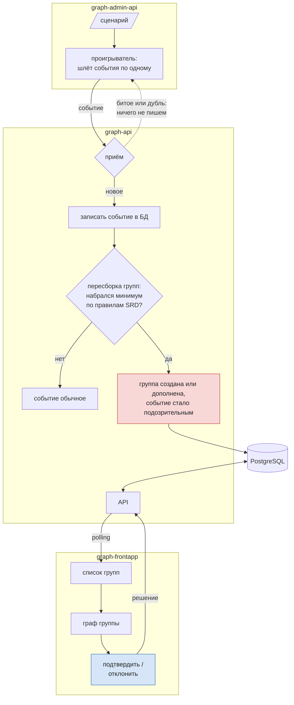
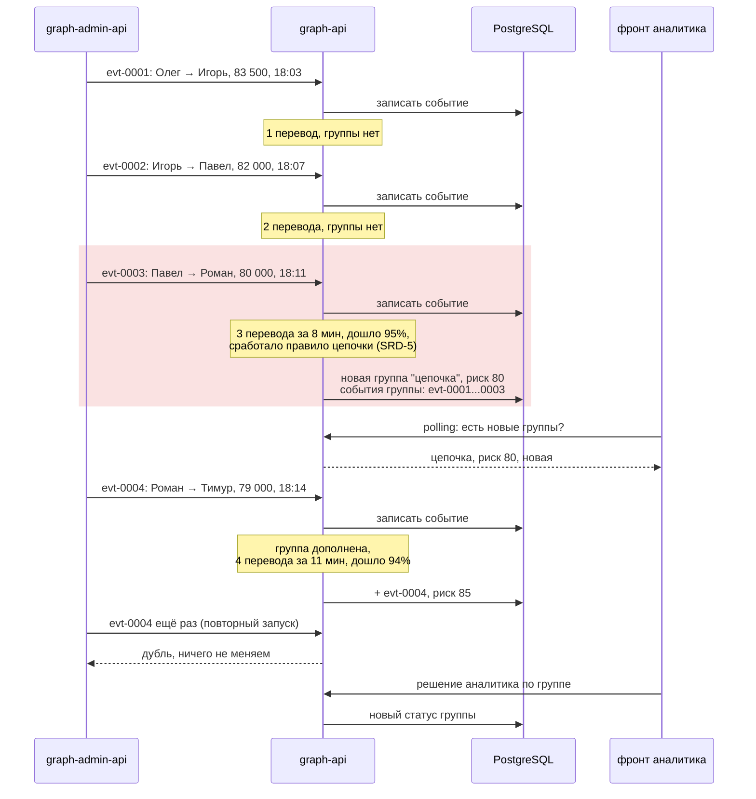
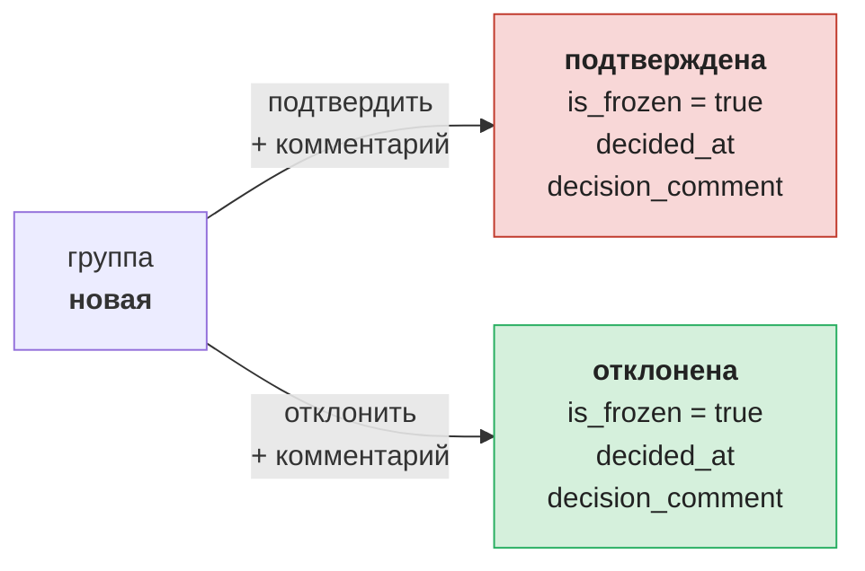

# Поток данных

Путь одного события: от сценария в админке до экрана аналитика и обратно, после решения аналитика.

## Общая картина

- **Подозрительное событие** - событие, которое попало в группу (`group_events`). Отдельного флага у события нет.
- Фронт получает не все события, а только группы и их подграфы.

## На примере цепочки

Сценарий "быстрая цепочка" из [schemes-simple.md](schemes-simple.md#схема-3-быстрая-цепочка): четыре перевода Олег -> Игорь -> Павел -> Роман -> Тимур.

Риск 80 = 55 (цепочка) + 20 (8 мин) + 0 (3 перевода) + 5 (дошло 95%). После четвёртого перевода: 55 + 15 + 10 + 5 = 85.

## Решение аналитика

Что graph-api меняет в `groups` после нажатия кнопки:

После решения ничего не удаляется: группа остаётся в БД, просто меняет статус. Жизненный цикл группы описан в [schemes-simple.md](schemes-simple.md#жизнь-группы).
