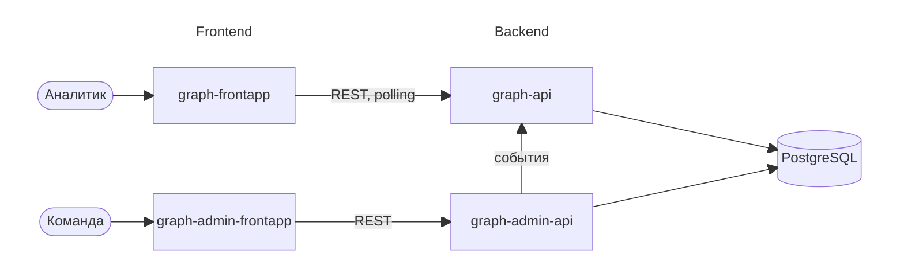

# RFC 01: нулевой RFC

## Контекст и цель проекта

TODO (@goshayjakov): проверить формулировки и дополнить с точки зрения предметной области.

В цифровом банке отдельная операция может выглядеть совершенно обычно, хотя её участники входят в связанную мошенническую сеть. Несколько счетов заходят с одного устройства или IP, переводят деньги одним и тем же получателям, а деньги быстро проходят через цепочку промежуточных счетов. По одной операции такое не поймать, нужно смотреть на связи.

ShuGraph строит граф из клиентов, счетов, устройств и сетевых адресов по потоку операций и событий входа. Граф обновляется по мере поступления событий, система ищет в нём подозрительные группы и считает оценку риска. Аналитику мы показываем подграф связей с признаками, из-за которых оценка выросла. Решение по каждой находке принимает аналитик: подтверждает или отклоняет.

## Цели первого спринта

TODO (@goshayjakov): что конкретно хотим получить к концу первого спринта.

## Не-цели первого спринта

TODO (@goshayjakov): что сознательно откладываем на следующие спринты или второй семестр.

## Общая схема системы

Система разделена на две независимые половины: основную (то, чем пользуется аналитик) и админскую (то, через что мы кормим основную данными).

- **graph-api** - ядро системы. Принимает события, отсекает дубли, обновляет граф, ищет подозрительные группы и считает оценку риска. Про генератор ничего не знает: для него это просто один из источников событий.
- **graph-frontapp** - рабочее место аналитика: очередь находок, карточка расследования, интерактивный граф. Ничего не вычисляет сам, только берёт данные из graph-api и удобно их показывает. Новые находки подтягивает через polling API.
- **graph-admin-api** - генератор обычного поведения и мошеннических схем с разметкой. Отправляет сгенерированные события в graph-api тем же путём, каким их мог бы прислать любой другой источник.
- **graph-admin-frontapp** - простая админка: запустить генерацию, выбрать схемы, и прочие служебные вещи.
- **PostgreSQL** - основное хранилище. Как именно сервисы делят базу, описано в [backend.md](backend.md).

Почему не один сервис: основная часть не должна зависеть от генератора. Генератор нужен только для разработки и демо, масштабировать его незачем, а у graph-api при необходимости можно поднять несколько реплик. BFF не делаем, для учебного проекта это лишний слой.

Все сервисы живут в одном репозитории: бэкенд в `backend/`, фронтенд в `frontend/`, внутри по папке на сервис.

## Оглавление

- [business.md](business.md) - определения предметной области, пользовательские сценарии, фичи первого спринта
- [backend.md](backend.md) - стек и архитектура бэкенда, хранение данных
- [frontend.md](frontend.md) - стек и архитектура фронтенда
- [ci.md](ci.md) - сборка и развёртывание на тестовую и продовую площадки
- [team.md](team.md) - командные процессы
