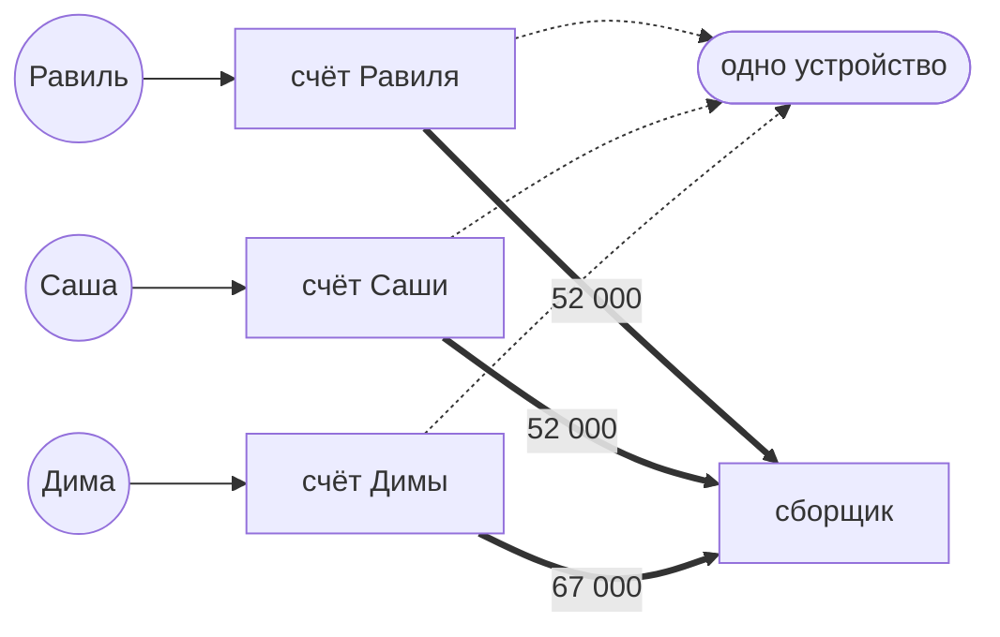
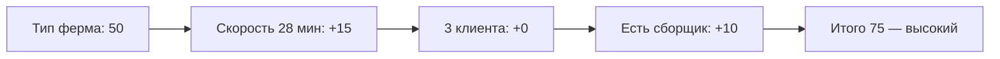
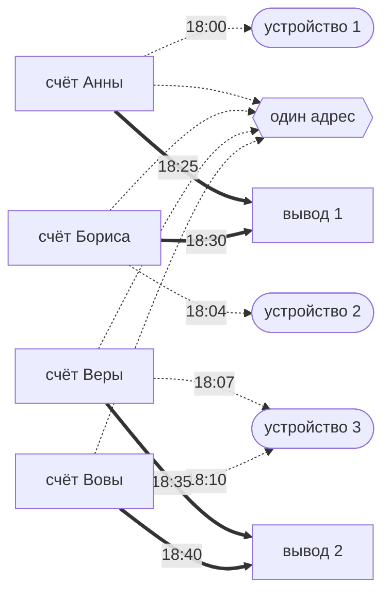
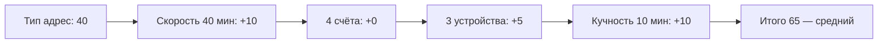
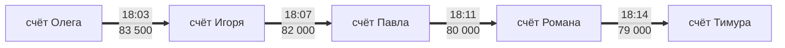
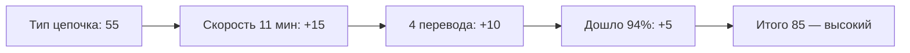
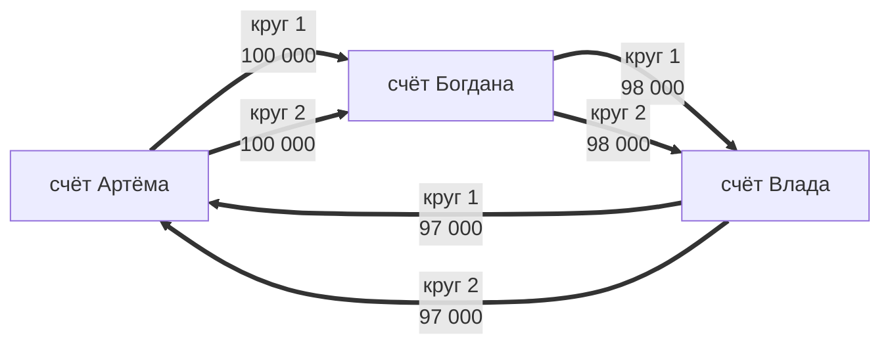
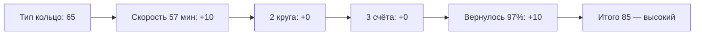

# Подсчет рисков

## Как считается

```text
риск = минимум(100, тип схемы + скорость + масштаб)
```

Уровни риска:

| Уровень | Диапазон |
|---|---|
| низкий | 0–59 |
| средний | 60–74 |
| высокий | 75–100 |

## Тип и скорость

Тип:

| Тип | Баллы |
|---|---|
| ферма | 50 |
| адрес | 40 |
| цепочка | 55 |
| кольцо | 65 |

Скорость (для всех схем одинаковая). `span` — время от первого до последнего события группы:

| span | Бонус |
|---|---|
| до 10 мин | +20 |
| 11–30 мин | +15 |
| 31–60 мин | +10 |
| 61–180 мин | +5 |
| больше 3 часов | +0 |

`span` считаем в целых минутах, дробь отбрасываем.

Примечание: `span` считается по всей группе, от первого до последнего события, поэтому опоздавшее событие снижает бонус: два круга за 2 минуты дают +20, а третий круг через 20 часов растянет `span` и обнулит бонус. Риск пересчитывается при каждом дополнении группы, пока она не заморожена. Затухание скорости от таких хвостов — известное ограничение MVP.

---

## 1. Одно устройство на толпу

Минимум: 3 разных клиента с одного устройства за 24 часа.

Масштаб:

| Клиентов | Баллы |
|---|---|
| 3 | +0 |
| 4 | +5 |
| 5 | +10 |
| 6 и больше | +15 |

| Общий счет куда переводят деньги (сборщик)| Баллы |
|---|---|
| есть | +10 |
| нет | +0 |

Пример:



Как сложился риск:



---

## 2. Общий адрес

Минимум: 4+ счетов заходили с одного адреса за 24 часа + устройства разные (2+ разных) + деньги ушли на общий счёт вывода. Плюс кучность по времени: у каждого счёта берём его самый ранний вход в окне и все эти первые входы должны уложиться в 60 минут.

Масштаб:

| Счетов | Баллы |
|---|---|
| 4 | +0 |
| 5–6 | +10 |
| 7+ | +15 |

| Устройств | Баллы |
|---|---|
| 2 | +0 |
| 3–4 | +5 |
| 5+ | +10 |

| Кучность первых входов | Баллы |
|---|---|
| до 10 мин | +10 |
| 11–30 мин | +5 |
| 31–60 мин | +0 |

Кучность считаем в целых минутах, дробь отбрасываем.

Пример:



Как сложился риск:



## 3. Цепочка

Минимум: 3+ переводов подряд, всё за 60 минут, до конца дошло 90%+ первой суммы.

Масштаб:

| Переводов (хопов) | Баллы |
|---|---|
| 3 | +0 |
| 4 | +10 |
| 5+ | +15 |

Сколько дошло (`сумма последнего перевода * 100 / сумма первого перевода`, дробь отбрасываем; больше 100 считаем за 100):

| Дошло | Баллы |
|---|---|
| 90–92% | +0 |
| 93–95% | +5 |
| 96–98% | +10 |
| 99–100% | +15 |

Пример:



Как сложился риск:



## 4. Кольцо

Минимум: круг из 3–5 счетов + 2+ полных круга за 24 часа.

Масштаб:

| Кругов | Баллы |
|---|---|
| 2 | +0 |
| 3 | +10 |
| 4+ | +15 |

| Счетов в кольце | Баллы |
|---|---|
| 3 | +0 |
| 4 | +5 |
| 5 | +10 |

Сколько вернулось (`сумма последних переводов засчитанных кругов * 100 / сумма первых переводов тех же кругов`, дробь отбрасываем; засчитанный круг — возврат ≥90%):

| Вернулось | Баллы |
|---|---|
| 90–92% | +0 |
| 93–95% | +5 |
| 96–98% | +10 |
| >=99% | +15 |

Пример:



Как сложился риск:

