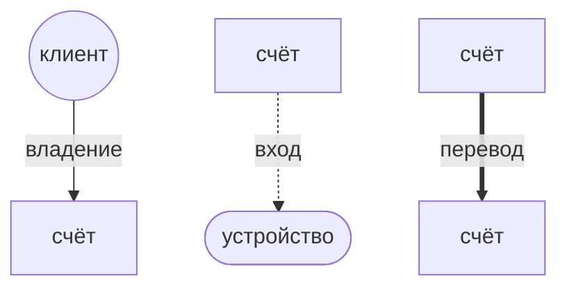
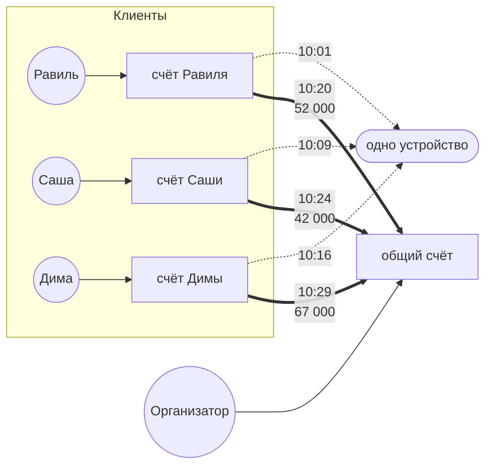
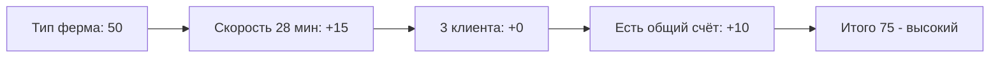
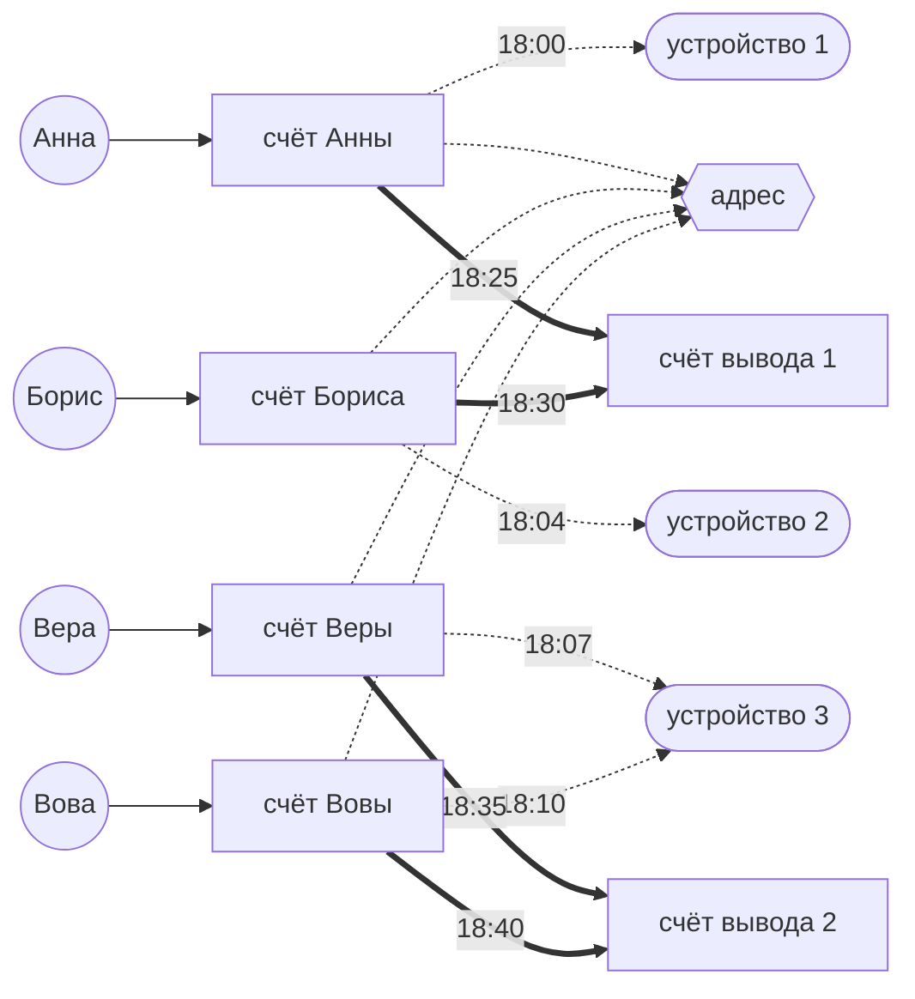
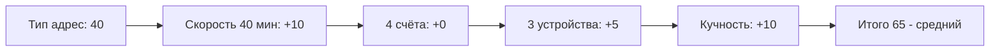
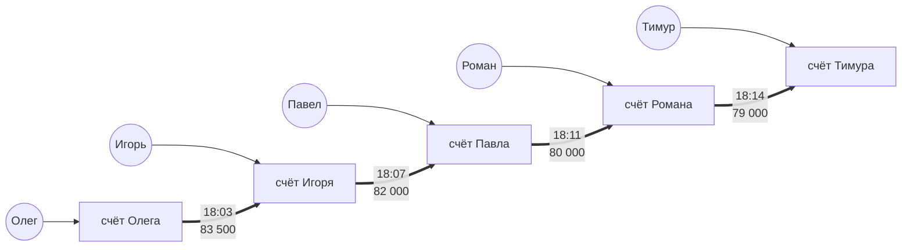
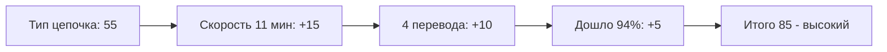
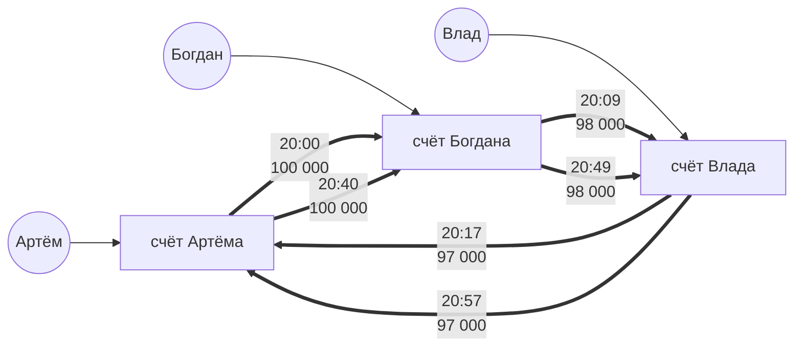
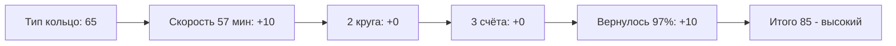

# Схемы и правила простыми словами

В систему текут события двух видов: **входы** (кто-то зашёл в кабинет) и **переводы** (деньги ушли со счёта на счёт).
Набрался минимум по любому правилу - появляется **группа**. Группу разбирает аналитик.

## Обозначения

## Схема 1. Одно устройство на толпу

**Что увидит аналитик:** несколько счетов с разными владельцами сходятся на одном устройстве, а деньги со всех уходят на один общий счёт.

**Пример графа:**

**Правило обнаружения (SRD-3)** >=3 разных клиентов заходили с одного устройства за 24 часа.

**Как сложился риск:**

*Подробнее про подсчет риска в [risk.md](risk.md)*

---

## Схема 2. Общий адрес - "один адрес на толпу"

**Что увидит аналитик:** счета с разными владельцами и разными устройствами сходятся на одном сетевом адресе, а деньги уходят на вывод. Устройства разные, адрес один.

**Пример графа:**

**Правило обнаружения (SRD-4)** >=4 счетов с одного адреса + >=2 разных устройств + все первые входы за 60 минут + есть общий счёт вывода.

**Как сложился риск:**

*Подробнее про подсчет риска в [risk.md](risk.md)*

---

## Схема 3. Быстрая цепочка

**Что увидит аналитик:** цепочка счетов без общих устройств и адресов. Входов тут вообще нет - только сплошные стрелки переводов, деньги пролетают и почти не уменьшаются.

**Пример графа:**

**Правило обнаружения (SRD-5)** >=3 переводов подряд, всё за 60 минут, до конца дошло >=90% первой суммы.

**Как сложился риск:**

*Подробнее про подсчет риска в [risk.md](risk.md)*

---

## Схема 4. Кольцо - "деньги по кругу"

**Что увидит аналитик:** то же, что в цепочке, но деньги возвращаются на стартовый счёт. Второй круг нарисован поверх первого.

**Пример графа:**

**Правило обнаружения (SRD-6)** круг из 3-5 счетов с возвратом не менее 90% суммы первого перевода в каждом круге + >=2 полных кругов за 24 часа.

**Как сложился риск:**

*Подробнее про подсчет риска в [risk.md](risk.md)*

---

## Жизнь группы

1. Группа всегда рождается со статусом **"новая"**.
2. Аналитик смотрит граф и карточку и нажимает **"подтвердить"** или **"отклонить"** с комментарием.
3. После решения группа **замораживается** - новые события в неё уже не идут.
4. Если решения не было, а события стали старше 24 часов - группу тоже замораживаем.
