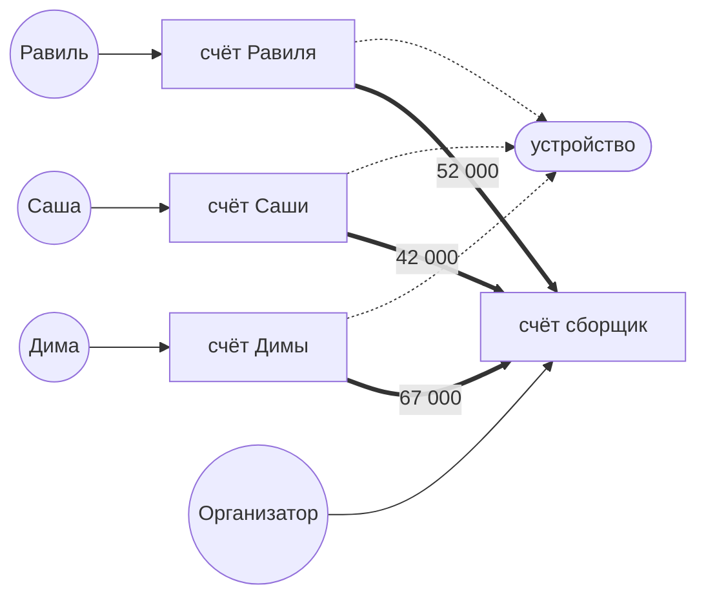
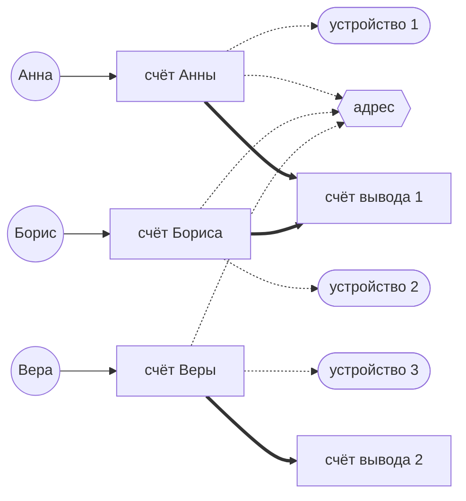
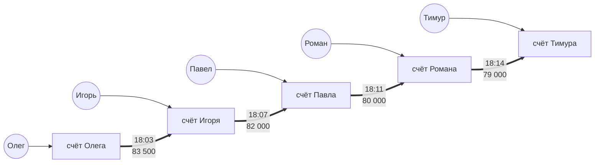
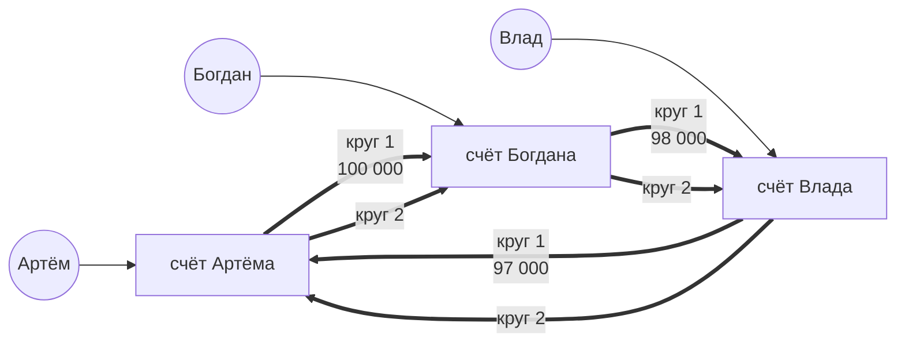

# Схемы и правила простыми словами

В систему текут события двух видов: **входы** (кто-то зашёл в кабинет) и **переводы** (деньги ушли со счёта на счёт).
Набрался минимум по любому правилу — появляется **группа**. Группу разбирает аналитик.

## Обозначения

## Схема 1. Ферма дропов — «одно устройство на толпу»

**Что увидит аналитик:** несколько счетов с разными владельцами сходятся на одном устройстве, а деньги со всех уходят на один счёт-сборщик.

**Пример графа:**

**Правило обнаружения** ≥3 разных клиентов заходили с одного устройства за 24 часа.

---

## Схема 2. Общий адрес — «один адрес на толпу»

**Что увидит аналитик:** счета с разными владельцами и разными устройствами сходятся на одном сетевом адресе, а деньги уходят на вывод. Устройства разные, адрес один.

**Пример графа:**

**Правило обнаружения** ≥4 счетов с одного адреса + ≥2 разных устройств + все первые входы за 60 минут + есть общий счёт вывода.

---

## Схема 3. Быстрая цепочка — «транзит»

**Что увидит аналитик:** цепочка счетов без общих устройств и адресов. Входов тут вообще нет — только сплошные стрелки переводов, деньги пролетают и почти не уменьшаются.

**Пример графа:**

**Правило обнаружения** ≥3 переводов подряд, всё за 60 минут, до конца дошло ≥90% первой суммы.

---

## Схема 4. Кольцо — «деньги по кругу»

**Что увидит аналитик:** то же, что в цепочке, но стрелки замыкаются на стартовый счёт. Рёбра параллельные — второй круг ложится поверх первого, а не схлопывается.

**Пример графа:**

**Правило обнаружения** круг из 3–5 счетов + ≥2 полных кругов за 24 часа.

---

## Жизнь группы

1. Группа всегда рождается со статусом **«новая»**.
2. Аналитик смотрит граф и карточку и нажимает **«подтвердить»** или **«отклонить»** с комментарием.
3. После решения группа **замораживается** — новые события в неё уже не идут.
4. Если решения не было, а события состарились и выпали из окна 24ч — группу тоже замораживаем.
