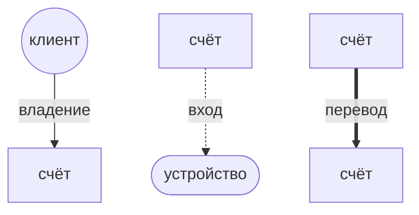

# Мошеннические схемы и правила их обнаружения

**SRD (Scheme Rules of Detection)** — правила обнаружения схем.

В систему текут события двух видов: **входы** (кто-то зашёл в кабинет) и **переводы** (деньги ушли со счёта на счёт). Набрался минимум по любому правилу — появляется **группа**. Группу разбирает аналитик.

Правовые обоснования схем — в [legal.md](legal.md), расчёт риска — в [risk.md](risk.md).

## Обозначения

## Схемы

- [Схема 1. Одно устройство на толпу](device-farm.md) — SRD-3
- [Схема 2. Один адрес на толпу](shared-address.md) — SRD-4
- [Схема 3. Быстрая цепочка](fast-chain.md) — SRD-5
- [Схема 4. Кольцо](ring.md) — SRD-6

Короткие обозначения в типах групп, фильтрах и риске: **ферма**, **адрес**, **цепочка**, **кольцо**.

## Общие правила

Действуют для всех схем.

- Все пороги на все правила могут меняться в любой момент. Это должно быть отражено в документации.

**SRD-1. Окно 24 часа (UTC).** Окно — скользящие 24 часа назад от времени последнего события группы.

**SRD-2. Когда появляется группа.** Группа появляется, когда за окном набрался минимум хотя бы по одному признаку из SRD-3–SRD-6 (тексты — в файлах схем выше). Минимум задан в единицах каждого правила (клиенты — для устройства и адреса, переводы — для цепочки и кольца). Минимум не набран — группы нет.

**SRD-7. Расчёт риска.** Риск складывается из: масштаба (больше счетов и событий — выше), скорости (короче время — выше), сохранности суммы (больше дошло — выше), повтора (кольцо на 2+ кругов — выше). Точные числа с планками — в [risk.md](risk.md).

**SRD-8. Что видно по умолчанию.** По умолчанию в списке — группы со статусом «новая».

**SRD-9. Пересечение, обновление, жизненный цикл.** Одни и те же счета могут дать две группы разных типов - показываем обе независимо (для MVP). Аналитик переводит группу из «новая» в «подтверждена» или «отклонена» (с комментарием). Смена решения после вынесения (подтверждена ↔ отклонена, возврат в новую) — вне MVP. Обновления: все обновления происходят пока события в группе не вышли из скользящего окна (SRD-1). Как только события выходят из окна то перестаем обновлять группу и фиксируем её.

## Жизнь группы

1. Группа всегда рождается со статусом **«новая»**.
2. Аналитик смотрит граф и карточку и нажимает **«подтвердить»** или **«отклонить»** с комментарием.
3. После решения группа **замораживается** — новые события в неё уже не идут.
4. Если решения не было, а события стали старше 24 часов — группу тоже замораживаем.

Подробнее про группы и схему БД — в [entities.md](../entities.md).
