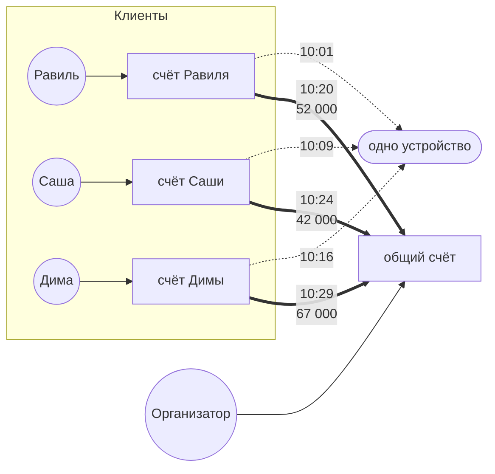
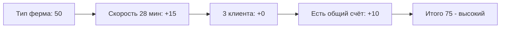

# Схема 1. Одно устройство на толпу

**Что увидит аналитик:** несколько счетов с разными владельцами сходятся на одном устройстве, а деньги со всех уходят на один общий счёт.

**Легенда:** организатор вербует подставных лиц (дропов). Жертвы, введённые в заблуждение, переводят деньги дропам; дропы перегоняют их дальше на счёт вывода, подконтрольный организатору (сборщик). Все дропы «работают» с одного телефона.

**Пример по шагам:**
- Сначала жертвы переводят деньги дропам.
- Равиль, Саша и Дима по очереди заходят с одного и того же устройства и переводят деньги сборщику.
- Остатки на счетах дропов почти нулевые: всё полученное от жертв ушло сборщику. Раньше эти клиенты между собой никак не пересекались.

**Пример графа:**

**Правило обнаружения (SRD-3).** Не меньше 3 разных клиентов заходили с одного устройства за окно (смотрят только события входа, у переводов устройства нет). Считаются уникальные клиенты: три счёта одного клиента — не группа. Исключений для семьи в MVP нет: двое с планшета не срабатывают в любом случае, трое и больше — срабатывают и разбираются аналитиком.

**Как сложился риск:**

*Подробнее про подсчёт риска — в [risk.md](risk.md).*

**Правовое приложение:** [схема 1](legal.md#схема-1-одно-устройство-на-толпу).