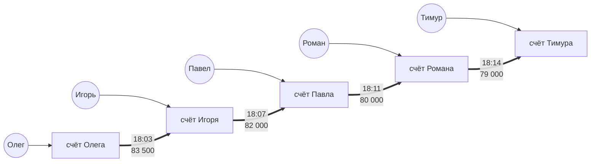
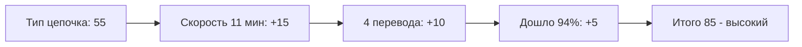

# Схема 3. Быстрая цепочка

**Что увидит аналитик:** цепочка счетов без общих устройств и адресов. Входов тут вообще нет — только сплошные стрелки переводов, деньги пролетают и почти не уменьшаются.

**Легенда:** деньги прогоняют через цепочку посредников, чтобы замести след.

**Пример по шагам:**
- Сначала счёт Олега получает деньги.
- Дальше переводы идут один за другим через Игоря, Павла и Романа к Тимуру: каждый посредник почти ничего себе не оставляет, деньги не лежат — пролетают.

**Пример графа:**

**Правило обнаружения (SRD-5).** Не меньше 3 переводов между счетами цепочки (итого минимум 4 счёта). Весь путь укладывается в 60 минут, до конечного счёта дошло не меньше 90% суммы первого перевода цепочки.

**Как сложился риск:**

*Подробнее про подсчёт риска — в [risk.md](risk.md).*

**Правовое приложение:** [схема 3](legal.md#схема-3-быстрая-цепочка).
