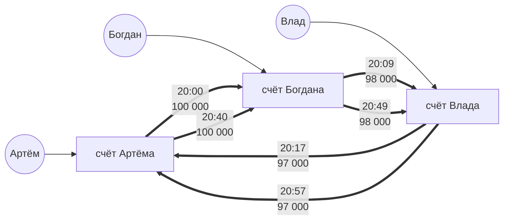
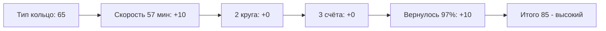

# Схема 4. Кольцо

**Что увидит аналитик:** деньги идут по кругу и возвращаются на стартовый счёт; второй круг нарисован поверх первого. В отличие от цепочки, здесь важны цикличность и повтор, а не линейный транзит.

**Легенда:** деньги крутят по кругу между своими: в выписке появляется «оборот», а след запутывается.

**Пример по шагам:**
- Деньги идут по кругу от Артёма к Богдану, дальше к Владу и возвращаются на стартовый счёт.
- Затем круг повторяется тем же составом.

**Пример графа:**

**Правило обнаружения (SRD-6).** Круг из 3–5 счетов с возвратом на стартовый счёт не менее 90% суммы первого перевода в круге + не меньше 2 полных кругов за окно. Одиночный круг без повтора группу не создаёт (например, возврат долга).

**Как сложился риск:**

*Подробнее про подсчёт риска — в [risk.md](risk.md).*

**Правовое приложение:** [схема 4](legal.md#схема-4-кольцо).
