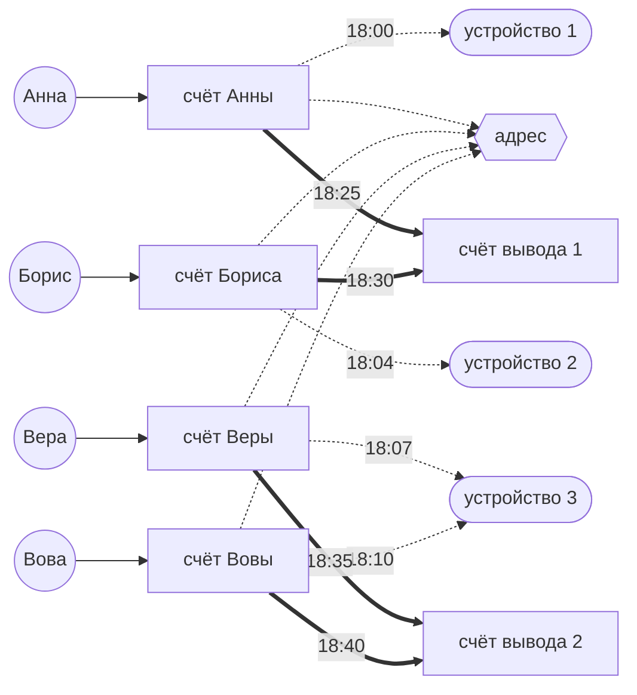
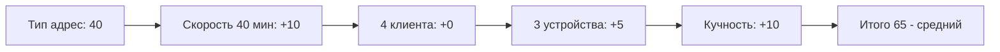

# Схема 2. Один адрес на толпу

**Что увидит аналитик:** счета с разными владельцами и разными устройствами сходятся на одном сетевом адресе, а деньги уходят на вывод. Устройства разные, адрес один.

**Легенда:** много «разных» устройств, но все выходят в сеть из одной точки — будто за всеми ними сидит один оператор.

**Пример по шагам:**
- 4 клиента с разными устройствами заходят с одного сетевого адреса: Анна, Борис, Вера и Вова.
- 18:00–18:10 — первые входы всех четверых уложились в 10 минут; Вова заходит с устройства Веры.
- 18:25–18:40 — со счетов уходят переводы на два общих счёта вывода.

**Пример графа:**

**Правило обнаружения (SRD-4).** Не меньше 4 разных клиентов, чьи входы идут с одного адреса за окно, + не меньше 2 разных устройств (то есть не все входы с одного устройства) + первые входы всех клиентов внутри 60 минут + денежные связи (переводы со счетов этих клиентов на общие счета вывода). «Первый вход» = самый ранний вход клиента по любому из его счетов в окне: правило смотрит только на входы, у переводов адреса нет. Берём самый ранний вход каждого из 4+ клиентов, все они должны уложиться в 60 минут. Считаются уникальные клиенты: четыре счёта одного клиента — не группа. Пометка о возможном общем адресе провайдера добавляется в карточку как контекст, но не является самостоятельным основанием для повышения риска.

**Как сложился риск:**

*Подробнее про подсчёт риска — в [risk.md](risk.md).*

**Правовое приложение:** [схема 2](legal.md#схема-2-один-адрес-на-толпу).