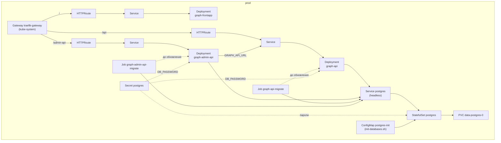

# Деплой

Здесь лежат Helm chart'ы и helmfile, по которым workflow `deploy` выкатывает сервисы в k3s на нашей ВМ. Про саму ВМ: [../vm/README.md](../vm/README.md). Какие есть площадки и когда выкатываться: [ci.md](../../docs/rfc/01-zeroth-rfc/ci.md).

- `charts/app` - общий chart для всех сервисов. Он создаёт Deployment, Service и HTTPRoute (маршрут в Traefik по префиксу пути), а для бэкендов с базой ещё Job, который применяет миграции.
- `charts/postgres` - один Postgres на площадку, в нём у каждого бэкенда своя база и свой пользователь.
- `helmfile.yaml.gotmpl` - список release'ов: какой chart ставить для каждого сервиса и с какими настройками (образ, порт, переменные окружения, путь). Настройки площадок лежат в `environments/`, пока там только `prod`.

Что получается в namespace `prod`:



У каждого сервиса Service, Deployment и HTTPRoute называются как release.

## Как выкатить

1. На GitHub: Actions -> `deploy` -> Run workflow.
2. В "Use workflow from" выбрать ветку, из которой собирать образы.
3. Выбрать площадку и отметить сервисы, которые нужно обновить. По умолчанию отмечены все.
4. Дождаться конца запуска. Workflow сам включит ВМ, соберёт образы с тегом по хешу коммита и обновит сервисы. Проверки он прогонит, только если у коммита ещё нет успешных. Адрес площадки будет в summary запуска.
5. Если ВМ больше не нужна, выключить её workflow `down`.

То же из терминала, эта команда выкатит всё, кроме `graph-frontapp`:

```bash
gh workflow run deploy.yml --ref GSD-42 -f environment=prod -f graph-frontapp=false
```

### Деплой перед мержем

PR, который меняет сервисы, `infra/` или деплой, можно смержить только после деплоя на prod: до этого статус `deploy/prod` у PR висит в pending. Чтобы его закрыть:

1. Подлить в ветку свежий `main`. Если ветка отстаёт, деплой на prod упадёт.
2. Выкатить ветку на prod со всеми сервисами. Деплой части сервисов статус не меняет.
3. Проверить изменения на prod и смержить PR.

Если после этого в `main` смержат другой PR, шаги придётся повторить.

В PR не в `main` статус всегда висит в pending с текстом "Игнорируй, пока база PR не main": мерж в другие ветки он не блокирует, выкатывать такой PR не надо.

У PR от Dependabot статуса `deploy/prod` нет до первого деплоя: его токену запрещено писать статусы. Такой PR выкатывают на prod так же.

### Если упала миграция

Перед обновлением бэкенда Job применяет его миграции к базе. Если миграция упала, деплой завершается с ошибкой, а сервис продолжает работать на прошлой версии. Причину видно в логах Job (`<ip>` из summary запуска):

```bash
ssh -i ~/.ssh/shugraph shugraph@<ip> sudo k3s kubectl -n prod logs job/graph-api-migrate
```

## Как добавить новый сервис

1. Добавить release в `helmfile.yaml.gotmpl`, проще всего скопировав похожий сервис.
2. В `deploy.yml` добавить сервис в список в job `plan` и галочку с тем же именем в `inputs`.
3. Если сервису нужна база: пароль в `passwords` в `charts/postgres/values.yaml`, вызов `create_database` в `init-databases.sh` и `DATABASE_URL` в release, как у `graph-api`. На работающей площадке базу ещё нужно создать вручную (см. "Пароли Postgres").

## Пароли Postgres

При первом деплое площадки chart postgres генерирует пароли и сохраняет их в Secret `postgres`, а при следующих деплоях берёт их оттуда. Пользователей и базы с этими паролями создаёт скрипт [init-databases.sh](charts/postgres/files/init-databases.sh). Postgres запускает его один раз, когда том ещё пустой, поэтому:

- Secret `postgres` удалять нельзя. Следующий деплой сгенерирует новые пароли, а в базе останутся старые, и бэкенды не смогут подключиться.
- Если новый бэкенд появился на площадке, где Postgres уже работает, его пользователя и базу нужно создать вручную теми же командами, что в `create_database`, с паролем из Secret.

## Container Registry

Образы хранятся в Yandex Container Registry `shugraph`. Скачивать их можно без авторизации, поэтому кластеру ключи не нужны, а загружает их CI под сервисным аккаунтом `shugraph-ci`.

Если реестр нужно создать заново (нужен `yc` с правами на каталог):

```bash
yc container registry create --name shugraph
yc container registry add-access-binding --name shugraph --role container-registry.images.puller --subject system:allUsers
yc container registry add-access-binding --name shugraph --role container-registry.images.pusher --service-account-name shugraph-ci
gh variable set YC_REGISTRY_ID --env vm --body "$(yc container registry get --name shugraph --format json | jq -r .id)"
```

Последняя команда записывает ID нового реестра в переменную `YC_REGISTRY_ID` окружения `vm` на GitHub: из неё workflow берёт адрес реестра.
